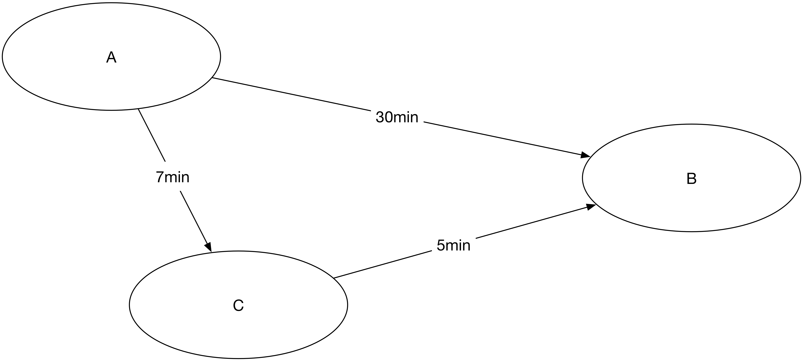

# WARNING: This assignment is not ready to work on yet.

# Introduction

You can find a tool for searching routes in a public transport network
at http://github.com/kaeluka/travel_planner.

In this exercise, you're going to

1. fork this project
-  extend it
-  send a pull request (PR).

This is a simulation of you contributing to an actual open source
project. As you might know, many open source projects have *"coding
conventions"* (see https://en.wikipedia.org/wiki/Coding_conventions)
and will not accept code that is not following these. This is in order
to avoid the quality of code deteriorating over time &mdash; which
would lead to less people being willing to contribute code.

As you will see, the `travel_planner` also has a set of coding
conventions. Your task is not only to write code that is working
correctly, but also code that is following the coding conventions. In
order to follow these, you might need to learn a few extra things.

You might need to learn more about:
- ... using `git` and `github`,
- ... how to configure your editor,
- ... how to write proper doxygen comments,
- ... how to use `CUnit`,
- ... how to use function pointers in C,
- or other things.

We are not going to *actually* merge your PR (sorry, but the other
students also need to be able to send their's), but we're going to
test it -- and we're going to check that you indeed follow the coding
conventions. If you don't follow them precisely, we won't be able to
accept the assignment.

## Your Task: Extending the Travel Planner

The travel planner reads in a specification of a public transport
network from a file. It then allows users to query this file,
searching routes from a starting location to a finishing location. The
tool will search a route that is not quite optimal: it will search the
shortest route in terms of number of bus stops on the way. However, if
you consider the network below, you will find that in order to go from
`A` to `B`, it is faster to go via `C` (only 12min, instead of 30min)!

The current implementation will always return the route with the
lowest number of steps instead the one with the overall shortest time.
**You will change that!**

### Steps

 1. Read and understand the code &mdash; you can use the documentation
   and the tests as help. If you find either unconvincing, feel free
   to improve them and send a PR. If we agree that it is an
   improvement, we will actually merge this -- provided it does not
   contain any part of your solution of course.
 - Implement the change.
 - Send a pull request.

# Suggested Level 3 Goals

- [A9 &mdash;
Demonstrera förståelse för designprincipen informationsgömning i ett C-program med hjälp av .c och .h-filer](http://auportal.herokuapp.com/achievements/9)
- [E10 &mdash;
Använda void-pekare i C-program för att uppnå genericitet på ett relevant sätt, t.ex. en datasamling som kan lagra godtyckligt data](http://auportal.herokuapp.com/achievements/10)
- [G15 &mdash;
Använda kopiering eller liknande för att undvika aliaseringsproblem i ett C- eller Javaprogram](http://auportal.herokuapp.com/achievements/15)
- [I22 &mdash;
Förklara innebörden av, och tillämpa på ett konsekvent sätt, defensiv programmering i ett program](http://auportal.herokuapp.com/achievements/22)
- [J27 &mdash;
Demonstrera förståelse för minneshantering i C genom att skriva ett program med dynamiska strukturer som är fritt från minnesläckage och argumentera för varför det är så (och verifiera med valgrind)](http://auportal.herokuapp.com/achievements/27)
- [M37 &mdash;
Använda pekare för att skapa länkade strukturer](http://auportal.herokuapp.com/achievements/37)
- [Q49 &mdash;
Ta fram lämpliga enhetstester, motivera dem, och förklara vad testerna visar](http://auportal.herokuapp.com/achievements/49)

# Suggested Level 4/5 Goals

- [A3 &mdash;
Demonstrera förståelse för designprincipen informationsgömning i ett C-program med hjälp av .c och .h-filer](http://auportal.herokuapp.com/achievements/3)
- [G18 &mdash;
Resonera kring hur inkapsling både kan försvåra och underlätta testning (ta gärna hjälp av kodexempel)](http://auportal.herokuapp.com/achievements/18)
- [K31 &mdash;
Givet ett icke-trivialt program uppdelat i moduler som i ovanstående mål, resonera kring begreppen coupling och cohesion för några av modulerna](http://auportal.herokuapp.com/achievements/31)
- [K32 &mdash;
Utveckla resonemanget i (4) med en diskussion om separation of concerns och hur detta har uppnåtts (alt. kan/inte kan) i programmet i fråga](http://auportal.herokuapp.com/achievements/32)
- [M39 &mdash;
Använda pekare till pekare (dubbelpekare) på ett lämpligt sätt i ett program](http://auportal.herokuapp.com/achievements/39)
